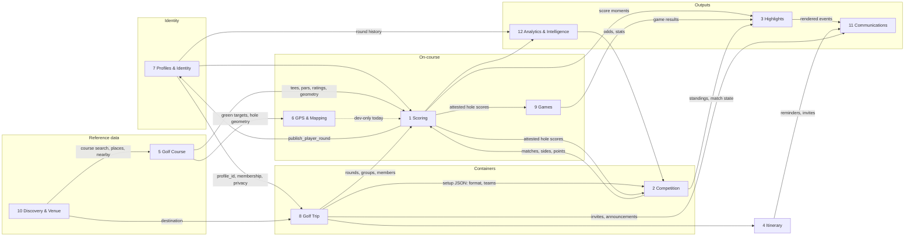
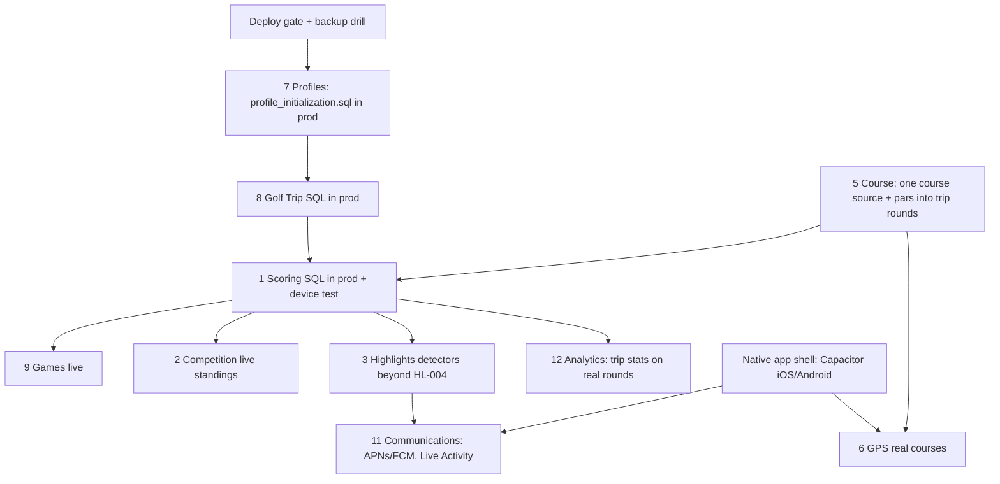

# The Maroon V2 — 12 Core Engines: Architecture & Progress Tracker

> **Living document.** Every claim here must be checkable against the repository.
> Last full audit: **2026-10-20** against `main` @ `cf85164c` (working tree had uncommitted marketing-site edits only).
> Audited by: Claude Code (Opus). Next agent: follow [§ 8 Update procedure](#8-update-procedure-for-coding-agents).

---

## 0. How to read this document

### 0.1 Evidence levels (used everywhere below)

Each piece of functionality is placed on exactly one rung. A rung is only claimed when the evidence column is true.

| Rung | Label | Evidence required |
|---|---|---|
| L0 | **Not started** | No code in the repo. |
| L1 | **Designed** | An approved spec section exists (`project_specs.md` or `docs/`), no code. |
| L2 | **Built** | Code is committed on `main` (or a named branch — say which). |
| L3 | **Locally tested** | Unit tests (`npm test`) and/or database tests on PGlite / the local auth stack pass. |
| L4 | **DB-activated** | The SQL it needs has been run in the **production** Supabase project, confirmed by the owner. |
| L5 | **Deployed** | The code is in the production Vercel deployment (check the deployed commit SHA). |

Two extra labels:
- **DEV-only** — runs only under `NODE_ENV=development`, the `/dev` simulator, or mock/sample data.
- **Unknown** — cannot be verified from the repo or tools available to the agent. Never upgrade Unknown to a rung without evidence.

### 0.2 Production facts used in this audit (re-verify each time)

| Fact | Value | How verified |
|---|---|---|
| Production deployment | Vercel project `maroon-masters-website`, commit **`8f6d17c3`** ("golf trip builder", 2026-10-08) | Vercel `list_deployments` (target=production), 2026-10-20 |
| Commits on `main` since that deploy | **97** | `git rev-list --count 8f6d17c3..main` |
| `main` vs `origin/main` | Even (0 ahead) | `git rev-list --count origin/main..main` |
| Production database — V2 SQL confirmed run | **Only C1** (`supabase/platform_foundation.sql`) | Owner's read-only preflight query, 2026-10-01 (agent memory, not re-checkable from repo) |
| Production database — V1 legacy schema | In use by the live Maroon site (`supabase/schema.sql` + the September `live_*`, `broadcast_*`, wager, career files) | The live site depends on these tables; exact file-by-file run state is **Unknown** |
| DEV database (the `.env` Supabase) | Owner reported (2026-10-10) running: `profile_identity`, `tournament_player_identity`, `platform_next_edition`, `player_rounds`, `profile_read_model`, `golf_trip_scoring_corrections`; and (2026-10-06) `golf_course_data` | Agent memory only — **not repo-verifiable** |
| Native app shell | **None.** No `ios/`, `android/`, or `capacitor.config.*`. `@capacitor/core` + `@capacitor/haptics` are npm dependencies only. | `ls`, `package.json` |
| Unit + PGlite test suite (`npm test`) | **1,506 / 1,507 pass** (2026-10-20, ~12 min). The single failure is `lib/compliance/featureRegistry.test.ts` expecting 28 features while the registry lists more — a stale count check, not an engine defect. Another terminal had uncommitted code edits during the run. | `npm test` |
| Side branches with unmerged engine work | `accounts-a1` (`6a4fcc4d` Accounts V2 A1: email verification + onboarding); `deploy-gate` (`5dd818bd` block production builds until required SQL is installed) | `git log main..<branch>` |

**Consequence:** almost everything in V2 is at **L2–L3**. Anything committed after `8f6d17c3` is *not deployed*, and no V2 SQL beyond C1 is *DB-activated*. The V1 legacy Maroon live site (Admin Center, portal scoring, broadcast, wagers) is the only thing truly in production.

### 0.3 How completion % is calculated

Completion is **toward the V2.0 launch scope** of that engine (mobile app, real users), not toward "every idea ever discussed". Each engine is scored on six weighted gates; partial credit is allowed and the breakdown is shown so anyone can challenge it.

| Gate | Weight | Meaning |
|---|---|---|
| Spec | 10 | Approved design for the V2 scope |
| Logic | 30 | Core domain logic in code, with tests |
| UI | 20 | User-facing screens wired to that logic (not just DEV previews) |
| DB layer | 15 | SQL/RPCs written and tested locally (PGlite / local stack). Full marks if the engine needs no DB. |
| DB live | 10 | Required SQL run in production |
| Deployed | 15 | Code live in the production deployment |

Percentages are **estimates from evidence**, rounded to the nearest 5. They are not measurements of remaining effort.

---

## 1. Dashboard

| # | Engine | Status | % | Spec/Logic/UI/DB/DBlive/Deploy | Highest rung reached | Top blocker |
|---|---|---|---|---|---|---|
| 1 | Scoring | Testing | **65%** | 10/27/16/12/0/0 | L3 (+DEV DB reported) | No V2 scoring SQL in prod; saved-trip rounds lack real hole pars; no 3-phone real-device test |
| 2 | Competition | In Development | **50%** | 8/22/14/6/0/0 | L3 | Platform tournament SQL (CREATE/DASHBOARD/PUBLIC SITE/ACTIVITY/C2) not run; competition persisted only as setup JSON |
| 3 | Highlights | In Development | **45%** | 10/18/8/9/0/0 | L3 (shadow mode) | Only HL-001..004 detectors exist; `highlights_config.sql` not run; no delivery |
| 4 | Itinerary | In Development | **45%** | 10/16/12/7/0/0 | L3 | Travel plan Steps 2–5 not verified built; flights/plans SQL not run |
| 5 | Golf Course | In Development | **55%** | 6/22/12/12/0/3 | L3 + partial L5 | Course-architecture cleanup spec still "awaiting approval"; two course stores (V1 `live_courses` + V2 `golf_courses`); pars not flowing to trips |
| 6 | GPS & Mapping | In Development (prototype) | **30%** | 8/13/4/5/0/0 | L3, DEV-only | Gated to `NODE_ENV=development`; no Map ID; geometry coverage partial (OSM) |
| 7 | Profiles & Identity | Testing | **60%** | 10/27/16/13/0/0 | L3 (local auth stack) | `profile_initialization.sql` + `account_deletion.sql` not in prod; A1 on side branch; mobile bearer auth incomplete |
| 8 | Golf Trip | In Development | **60%** | 10/24/17/11/0/2 | L3 + early L5 | Prod has the 2026-10-08 trip build only; trip SQL run state in prod Unknown |
| 9 | Games | Testing | **60%** | 10/27/15/12/0/0 | L3 | `golf_trip_games.sql` not run; depends on Scoring going live |
| 10 | Discovery & Venue | In Development (early) | **30%** | 5/10/9/3/0/3 | L3 + partial L5 | No venue model/DB; category pages are placeholders; US-only course lookup |
| 11 | Communications | In Development | **30%** | 8/10/7/5/0/0 | L3, mostly DEV-only | No native app shell / APNs / FCM; chat + feed are page-memory only; push SQL not run |
| 12 | Analytics & Intelligence | In Development | **40%** | 6/20/12/2/0/0 | L3 (V2); L5 for V1 odds/career | Trip stats depend on scored rounds going live; no product analytics/telemetry |

Status vocabulary: **Not Started → Planning → In Development → Testing → Production Ready.** "Testing" here means code-complete for the current scope and verified locally/DEV, waiting on real DB + device testing. Nothing in V2 is **Production Ready** today.

---

## 2. Architecture map — how the engines communicate

**Contracts that exist in code today (verified):**

| From → To | Contract | Where |
|---|---|---|
| Scoring → Profiles | `submit_trip_scorecard` calls `publish_player_round` in the same transaction | `supabase/golf_trip_scoring_corrections.sql`, `docs/player-rounds-scoring-contract.md` |
| Scoring → Games | Games score from the attested scorecard (`HoleInput`) | `lib/platform/game-engine/`, `lib/platform/tripGames.ts` |
| Scoring → Highlights | Detectors read attested `TripRoundScoring` + pars | `lib/highlights/detect/scoreMoments.ts`, `roundPars.ts` |
| Highlights → Communications | Existing momentum pipeline: `trip_momentum_events` → `trip_push_deliveries` outbox → cron `/api/internal/trip-push` → web push | `supabase/golf_trip_momentum.sql`, `lib/platform/tripPush.ts`, `webPushTransport.ts`, `vercel.json` |
| Course → GPS | Provider-independent domain types + `gpsProvisioning` | `lib/platform/golfGps/domain/`, `gpsProvisioning.ts` |
| Discovery → Course | OpenGolf search + NWS-state nearby lookup | `app/api/courses/search`, `app/api/courses/near` |
| Profiles → everything | `getCurrentProfile()` → `profile_id` (ACCOUNT = login, PROFILE = golfer) | `lib/profile/currentProfile.ts` |

**Rule:** engines talk through these contracts (RPCs, typed functions). New engine work should add a row here rather than reaching into another engine's tables.

---

## 3. Dependency map — what must finish first

**Critical path to a usable V2 trip (in order):**
1. **Release plumbing** — backup/restore drill (`docs/restore-drill.md`) and the `deploy-gate` branch decision. Without these, no SQL should go to prod.
2. **Profiles & Identity in prod** — `profile_identity.sql` → `profile_initialization.sql` → `account_deletion.sql` (owner-run, in order), then deploy.
3. **Golf Trip + Scoring SQL in prod** — `golf_trips.sql`, `golf_trip_invitations.sql`, `golf_trip_setup.sql`, `player_rounds.sql`, the five `golf_trip_scoring*.sql` files (order matters: `player_rounds.sql` before `golf_trip_scoring_corrections.sql`).
4. **Course pars into saved trip rounds** — otherwise scoring/highlights/stats see `par: []`.
5. Everything downstream (Games, Competition standings, Highlights, Analytics) unlocks once 2–4 are live.
6. **Native shell** is independent and gates Communications (real push) and real GPS.

Exact SQL order is owned by `docs/production-migration-checklist.md`. This doc does not replace it.

---

## 4. Engine sections

Template for every engine: Purpose · Status · Completion · Built (by rung) · Missing · Dependencies · Next 3 · Code ownership · Milestones.

---

### 1. Scoring Engine

- **Purpose:** Capture hole-by-hole scores, attest them (player + attester), submit/lock scorecards, handle corrections, work offline, and publish one permanent round per account.
- **Status:** Testing · **Completion: 65%** (10/27/16/12/0/0)

**What is built**
| Capability | Rung | Evidence |
|---|---|---|
| V1 legacy Maroon live scoring (portal, Google Sheet / Supabase `live_*`, hole submissions, closeout) | L5 (V1, legacy) | `app/portal/scoring`, `lib/live/`, `supabase/live_hole_submissions.sql`, `live_round_submission.sql` |
| V2 saved-trip scoring: groups, hole ops, attestation, submission | L3 | `lib/platform/tripScoring.ts`, `tripSubmission.ts`, `tripScoringServer.ts`, `tripScoringDatabase.test.ts`; SQL `golf_trip_scoring.sql`, `_submission`, `_realtime`, `_offline` (`95fd5048`, `17c0b93a`, 2026-10-08) |
| Corrections (request/decide, revision snapshots, no self-approval) | L3 | `tripCorrections.ts`, `GolfTripCorrections.tsx`, `golf_trip_scoring_corrections.sql`, `_fix_groups.sql` (`03748a87`, `5c407fee`, `bd4ef69b`) |
| Offline queue + sync | L3 | `scoringQueue.ts`, `scoringQueueIdb.ts`, `scoringSync.ts` |
| Personal rounds ("Play a round", solo + invite-only shared) | L3 | `app/rounds/new`, `lib/platform/personalRound.ts`, `sharedRoundsServer.ts`, `supabase/shared_rounds.sql` (`a25ec1e5`) |
| Player rounds (one record per account → profile + handicap) | L3; DEV DB reported | `playerRounds.ts`, `playerRoundsServer.ts`, `supabase/player_rounds.sql` (`f9db2cce`) |
| Scoring UI sheet (score / scorecard / GPS pill, submit celebration) | L2 (UI) | `components/platform/GolfTripScoring.tsx`, `SubmitCelebration.tsx`, `OrganizerScorecard.tsx` |

**What's missing**
- No V2 scoring SQL run in production; not deployed (all of it post-dates `8f6d17c3`).
- Saved-trip rounds store only `course_name`; saved scoring receives `par: []` (reported by the 2026-10-20 Highlights par audit — re-verify in `lib/highlights/detect/roundPars.ts`).
- No per-group start hole (shotgun) in saved scoring.
- Real-device test with 3 accounts not done.
- Two parallel scoring stacks (V1 `live_*` and V2 `hole_score_entries`) — V1 retirement not planned in code.

**Dependencies:** Profiles (7), Golf Trip (8), Golf Course (5), Competition (2) for match sides.

**Next 3 priorities**
1. Feed real pars/tees from the course library into saved-trip rounds (`golf_trip_rounds` → scoring).
2. Owner-run SQL in prod in checklist order (`player_rounds.sql` → scoring files → corrections), then deploy.
3. 3-phone real-device test of enter → attest → submit → correct; record result here.

**Code ownership**
- Files: `lib/platform/{tripScoring,tripSubmission,tripCorrections,tripRoundState,scoringQueue,scoringQueueIdb,scoringSync,scoreEdits,personalRound,playerRounds*,roundGroups,roundVisibility}.ts`, `lib/live/`, `lib/scorekeeper/`, `lib/portal/scorecard.ts`
- UI: `components/platform/{GolfTripScoring,OrganizerScorecard,OrganizerScores,GolfTripCorrections,SavedTripScorecards,PlayRound,SubmitCelebration}.tsx`, `components/portal/`, `components/scorecard/`
- Tables: `scoring_groups`, `scoring_group_players`, `hole_score_entries`, `scorecard_submissions`, `scorecard_correction_requests`, `scorecard_submission_revisions`, `player_rounds`, `shared_rounds*`; V1: `live_hole_scores`, `live_round_state`, `live_match_box*`, `live_hole_submissions`
- APIs: `/api/golf-trips/[tripId]/scoring{,/submit,/corrections}`, `/api/rounds/*`, V1 `/api/portal/scoring/*`, `/api/portal/score/*`
- Docs: `docs/player-rounds-scoring-contract.md`, `docs/golf-trip-scoring-review.md`, `docs/scoring-reliability-release.md`

---

### 2. Competition Engine

- **Purpose:** Define how a trip or tournament is contested — formats, teams, captains, drafts, matches, points, leaderboards and standings — for Golf Trips and platform Tournaments.
- **Status:** In Development · **Completion: 50%** (8/22/14/6/0/0)

**What is built**
| Capability | Rung | Evidence |
|---|---|---|
| Format catalog (Singles/Fourball/Foursome + golf formats, match/stroke, gross/net/both) | L3 | `lib/platform/formats.ts`, `roundCompetition.ts`, `golfFormats.test.ts`, `roundCompetition.test.ts` |
| Team draft, match draft (ranks / randomized), draft room | L3 (UI DEV-heavy) | `teamDraft.ts`, `matchDraft.ts`, `matchDraftSession.ts`, `TripDraftRoom.tsx`, `TripMatchDraftRoom.tsx` |
| Team captains, team colors | L3 | `teamCaptains.ts`, `teamColors.ts` |
| Match center, leaderboard ordering, competition preview | L3 | `matchCenter.ts`, `golfLeaderboardOrder.ts`, `golfTripCompetitionPreview.ts`, `GolfTripCompetition.tsx`, `GolfTripMatch.tsx` |
| Historical trip standings | L3 | `historicalTripStandings.ts` |
| Platform Tournaments (create, dashboard, public site `/t/`, `/play`, invites, next edition) | L3; only C1 in prod | `lib/platform/{tournament*,dashboard*,publicSite*,nextEdition}.ts`, `supabase/platform_*.sql` |
| V1 Maroon matches/standings/closeout | L5 (V1) | `app/leaderboard`, `lib/live/officialMatchState.ts`, `live_match_official_state` |

**What's missing**
- Golf Trip competition settings persist inside `golf_trip_setup` JSON — no dedicated matches/standings tables for trips (verify before building one).
- Platform tournament SQL beyond C1 not in prod (CREATE, DASHBOARD, PUBLIC SITE, ACCESS REQUESTS, PAST, ACTIVE, ACTIVITY, C2).
- Live standings computed from real attested scores not verified end-to-end for saved trips.
- Two competition containers (Golf Trip vs `/play` Tournament); owner decision 2026-10-09 put The Maroon in Golf Trips — `/play` migration paused.

**Dependencies:** Scoring (1), Golf Trip (8), Profiles (7); Analytics (12) for odds.

**Next 3 priorities**
1. Verify and document where saved-trip match results/standings are computed (setup JSON + attested scores) and close any gap.
2. Run the "Both" competition type end-to-end on DEV with real submissions.
3. Owner decision: keep or retire the `/play` Tournament competition path for V2.0.

**Code ownership**
- Files: `lib/platform/{formats,golfFormats*,roundCompetition,matchDraft*,teamDraft,teamCaptains,teamColors,matchCenter,golfLeaderboardOrder,golfTripCompetitionPreview,competitionMatchNumber,historicalTripStandings,tournament*,dashboard*,publicSite*,nextEdition,editionScope,readiness}.ts`, `lib/leaderboard/`, `lib/fantasy/`
- UI: `components/platform/{GolfTripCompetition*,GolfTripMatch,TripDraftRoom,TripMatchDraftRoom,MatchDraftStatus,RoundCompetitionSettings,TripPlayerRoles}.tsx`, `components/platform/play/`, `components/platform/tournament-site/`
- Tables: `golf_trip_setup` (JSON), `tournaments`, `tournament_editions`, `edition_*`, `tournament_members`, `tournament_players`, `tournament_activity`; V1 `live_match_official_state`, `live_roster*`
- APIs: `/api/golf-trips/[tripId]/setup`, `/api/platform/tournaments/**`
- Docs: `docs/golf-trip-competition-review.md`, `docs/team-captains-review.md`, `docs/trip-draft-room-review.md`, `docs/match-selector-review.md`

---

### 3. Highlights Engine

- **Purpose:** Turn scoring/competition events into short, editorially controlled messages ("birdie streak", "lead change"), using a Google-Sheet rulebook published as immutable config versions.
- **Status:** In Development · **Completion: 45%** (10/18/8/9/0/0)

**What is built**
| Capability | Rung | Evidence |
|---|---|---|
| H1 pure TS foundation (types, importer, catalog, template, validator) | L3 | `lib/highlights/*.ts` (`f2fd17c4`, `f3431dcc`) |
| H2/H2.1 XLSX import + message variations | L3 | `xlsxSource.ts`, `canonical.ts`, `draft.ts`, `scripts/check-highlights-xlsx.ts` (`7f71d7ad`) |
| H3 versioned config DB (drafts, immutable versions, active pointer, audit) | L3 (PGlite) | `supabase/highlights_config.sql`, `configRows.ts`, `configDatabase.test.ts` |
| H4 Highlights Admin (check, draft, publish, history, rollback) | L3 (fakes + PGlite; no browser/real Supabase test) | `app/portal/admin/highlights`, `/api/portal/admin/highlights/*`, `adminApi.ts` (`e6949e68`) |
| H4.5/H5A engine (eligibility, preferences, audience, selection, volume policy) | L3 | `lib/highlights/engine/` (`81e81e63`) |
| H5B detectors HL-001..004 in **shadow mode** | L3, DEV-only | `lib/highlights/detect/` (`b7f559aa`) |
| Simulator scenarios | DEV-only | `lib/dev/highlightScenarios.ts`, `detectionScenarios.ts`, `components/dev/HighlightScenarioControls.tsx` |
| Existing momentum pipeline (SQL triggers, separate from Highlights) | L2; SQL not run | `supabase/golf_trip_momentum.sql`, `TripMomentum*.tsx` |

**What's missing**
- Detectors for the remaining ~71 rules (sheet: 75 rules as of 2026-10-20).
- `highlights_config.sql` not run anywhere outside PGlite.
- Cutover from `golf_trip_momentum.sql` triggers to TS detectors (needs owner approval).
- Delivery (H6) — coordinated with Communications; no APNs/FCM.
- Depends on real pars in saved rounds (see Scoring).

**Dependencies:** Scoring (1), Competition (2), Games (9); delivers via Communications (11).

**Next 3 priorities**
1. H5C — next detector batch (owner approval needed).
2. Run `highlights_config.sql` on DEV and test the Admin in a real browser.
3. Agree H6 delivery interface with the notifications work (no competing token/prefs tables).

**Code ownership**
- Files: `lib/highlights/**`, `lib/dev/{highlightScenarios,detectionScenarios}.ts`, `lib/dev/highlightsSnapshot.json`, `scripts/build-highlights-snapshot.ts`, `scripts/check-highlights-xlsx.ts`
- UI: `app/portal/admin/highlights`, `components/dev/{HighlightScenarioControls,DetectionShadowControls}.tsx`
- Tables: `highlight_config_drafts`, `highlight_config_versions`, `highlight_config_active`, `highlight_config_audit`; (momentum) `trip_momentum_events`
- APIs: `/api/portal/admin/highlights{,/drafts,/publish,/rollback,/discard}`
- Spec: `project_specs.md` → "Highlights Engine — Google Sheet rulebook"

---

### 4. Itinerary Engine

- **Purpose:** Each traveler's flights, rides, lodging and plans, the group's shared view, invites to plans, and a self-building day-by-day itinerary (plus weather).
- **Status:** In Development · **Completion: 45%** (10/16/12/7/0/0)

**What is built**
| Capability | Rung | Evidence |
|---|---|---|
| Travel model, add/edit/remove, itinerary builder | L3 | `lib/platform/tripTravel.ts`, `golfTripItinerary.ts` (+tests) |
| Save & Invite, accept/decline invites to plans | L3 (logic); dev mock UI | `tripTravel.ts` (`inviteToItem`, `respondToInvite`, `goingOnly`) |
| Personal plans saved to DB with revisions | L3 | `savedTripTravel.ts`, `savedTripTravelServer.ts`, `/api/golf-trips/[tripId]/plans`, table `golf_trip_personal_plans` in `supabase/golf_trip_setup.sql` (`690f6e17`, `874c6429`) |
| Manual flights | L3; SQL not run | `golfTripFlights.ts`, `GolfTripFlights.tsx`, `supabase/golf_trip_flights.sql` (`9144baaa`) |
| Itinerary UI (My travel, detail sheet, kinds) | L2 | `GolfTripMyTravel.tsx`, `ItineraryDetailSheet.tsx`, `travelKinds.tsx` |
| NWS weather card | L3; partially L5 (weather lib is in `8f6d17c3`) | `lib/platform/weather/` |

**What's missing**
- Approved plan Steps 2–5 (group view, joining rides/"I'm on this flight", organizer "Who's going?" assignments + opt-out, notifications) — **Unknown**, not verified as built.
- Uninvite; bell notifications for plan invites.
- Flights/plans SQL not in prod; flight status lookups (no airline API).

**Dependencies:** Golf Trip (8), Profiles (7); notifies via Communications (11); location via Discovery (10).

**Next 3 priorities**
1. Audit which of travel Steps 2–5 exist and update this section.
2. Wire plan invites to the in-app bell once Communications Phase 2 exists.
3. Include `golf_trip_flights.sql` and `golf_trip_setup.sql` in the prod SQL plan.

**Code ownership**
- Files: `lib/platform/{tripTravel,golfTripItinerary,savedTripTravel,savedTripTravelServer,golfTripFlights,scheduleDateShift}.ts`, `lib/platform/weather/`
- UI: `components/platform/{GolfTripMyTravel,ItineraryDetailSheet,GolfTripFlights,travelKinds}.tsx`, `app/golf-trips/[tripId]/flights`
- Tables: `golf_trip_flights`, `golf_trip_personal_plans`
- APIs: `/api/golf-trips/[tripId]/flights{,/[flightId]}`, `/api/golf-trips/[tripId]/plans`

---

### 5. Golf Course Engine

- **Purpose:** The one source of truth for courses: identity, tees, pars, ratings/slopes, hole data, and (where available) geometry — with provenance and licensing.
- **Status:** In Development · **Completion: 55%** (6/22/12/12/0/3)

**What is built**
| Capability | Rung | Evidence |
|---|---|---|
| V1 Course Library (admin import, tees, locations, archived tees) | L5 (V1) | `app/portal/admin/course-library`, `live_courses`, `course_library_*.sql` |
| Provider-independent course domain + coverage levels | L3 | `lib/platform/golfGps/domain/` |
| OpenGolf provider (search/detail) | L3; L5 (search route is in `8f6d17c3`) | `providers/openGolf/`, `/api/courses/search` |
| OpenStreetMap geometry enrichment | L3 | `providers/openStreetMap/` |
| V2 course repository + library (provenance, refresh rules, staleness) | L3 (PGlite); DEV DB reported | `repository/`, `supabase/golf_course_data.sql` (`adc62098`) |
| Course search / profile in Explore, tee boxes, short names | L2–L3 | `ExploreCourseSearch.tsx`, `ExploreCourseProfile.tsx`, `RoundTeeBoxes.tsx`, `courseShortName.ts` |

**What's missing**
- "OpenGolf as the one source of course data" cleanup spec is **awaiting approval** (`project_specs.md`, 2026-10-06).
- Two stores: V1 `live_courses` vs V2 `golf_courses` — no migration between them.
- Pars/tees not flowing into saved-trip rounds.
- OpenGolf data quality issues (wrong pars/zips), 500 req/day/IP limit, ODbL share-alike obligations.

**Dependencies:** Discovery (10) for search entry points. Consumed by Scoring, GPS, Games, Analytics.

**Next 3 priorities**
1. Owner approval (or revision) of the course-architecture cleanup spec.
2. Link `golf_trip_rounds` to a course library id + tee set so pars reach scoring.
3. Data-quality guard: flag/override bad provider pars before they reach a scorecard.

**Code ownership**
- Files: `lib/platform/golfGps/{domain,providers,repository,courseEnrichment,coursePreview,nearbyCourses}*`, `lib/platform/courseShortName.ts`, `lib/data/{canonicalCourse,courseLibraryMatch,courseLocation}.ts`, `lib/live/teeSets.ts`, `lib/handicap/teeSetup.ts`
- UI: `components/platform/{ExploreCourseSearch,ExploreCourseProfile,RoundTeeBoxes,TripScheduleCoursePicker,GolfTripCoursesStep}.tsx`, `app/portal/admin/course-library`, `app/dev/course-search`
- Tables: `golf_courses`, `golf_course_sources`, `golf_course_external_ids`, `golf_tee_sets`, `golf_holes`, `golf_hole_tees`, `golf_hole_features`, `golf_green_targets`; V1 `live_courses`
- APIs: `/api/courses/search`, `/api/courses/[ref]`, `/api/rounds/course/[ref]`, `/api/portal/admin/courses{,/import}`
- Docs: `docs/course-library-api.md`

---

### 6. GPS & Mapping Engine

- **Purpose:** On-course distances (front/center/back), hole view, player location, and map rendering.
- **Status:** In Development (prototype) · **Completion: 30%** (8/13/4/5/0/0)

**What is built**
| Capability | Rung | Evidence |
|---|---|---|
| Distance math, hole-view camera math | L3 | `lib/platform/golfGps/{distance,holeView}.ts` (+tests) |
| Green targets derived from geometry | L3 | `golfGps/targets/` |
| GPS provisioning (library first, retry window, dedupe) | L3 | `gpsProvisioning.ts`, `/api/courses/[ref]/gps`, `/api/courses/library/[id]/gps` |
| GPS screen + HUD + map (Google Maps vector) | **DEV-only** | `components/platform/gps/`, `app/dev/gps`; gated by `process.env.NODE_ENV === "development"` in `GolfTripScoring.tsx` |
| Real/mock location, simulator GPS controls | DEV-only | `usePlayerLocation.ts`, `components/dev/useSimulatorGps.ts` |

**What's missing**
- Not available to real users (dev gate).
- No `NEXT_PUBLIC_GOOGLE_MAPS_MAP_ID` (falls back to `DEMO_MAP_ID`).
- Geometry coverage depends on OSM; many courses scorecard-only. No tracing from Google imagery (Google terms).
- Native location (Capacitor) not started; background location/battery not considered.

**Dependencies:** Golf Course (5), native shell (Communications/platform), Scoring (1) for the sheet it lives in.

**Next 3 priorities**
1. Owner decision on geometry source for launch (OSM only vs paid provider vs organizer pins).
2. Create a real Map ID and test vector hole view on a real phone.
3. Decide the release gate (feature flag instead of `NODE_ENV`).

**Code ownership**
- Files: `lib/platform/golfGps/**` (shared with Golf Course), `components/dev/useSimulatorGps.ts`
- UI: `components/platform/gps/`, `app/dev/gps`
- APIs: `/api/courses/[ref]/gps`, `/api/courses/library/[id]/gps`

---

### 7. Profiles & Identity Engine

- **Purpose:** Accounts (login), profiles (golfer), verification, onboarding, privacy, photos, sessions/devices, deletion, and claiming historical identity.
- **Status:** Testing · **Completion: 60%** (10/27/16/13/0/0)

**What is built**
| Capability | Rung | Evidence |
|---|---|---|
| V1 accounts (Supabase auth, `profiles`, `player_slots`, portal roles) | L5 (V1) | `supabase/schema.sql`, `lib/portal/require*.ts` |
| Profile identity (`profile_id` = `profiles.id`) | L3; DEV DB reported | `lib/profile/profileIdentity.ts`, `supabase/profile_identity.sql` |
| Accounts V2 signup + idempotent profile initialization | L3 (local auth stack, 55 checks reported) | `lib/auth/signup.ts`, `lib/profile/profileInitialization.ts`, `supabase/profile_initialization.sql` (`871dd7d4`, `bb00ca5d`) |
| Account deletion (hard delete, tombstones, organizer hand-off, retry cron) | L3 | `lib/account/accountDeletion.ts`, `supabase/account_deletion.sql`, `/api/account/delete`, `/api/internal/account-deletions` (`84d11d4f`) |
| Password security (A2) | L3 | `lib/auth/passwordPolicy.ts`, `lib/account/passwordChange.ts` (`50b304ec`) |
| Sessions & devices (A4) | L3 | `lib/account/sessions.ts`, `/api/account/sessions` (`b539427d`) |
| Email verification + first-time onboarding (A1) | L3 on **branch `accounts-a1` only** | `6a4fcc4d` |
| Profile read model, V1 setup/edit/bio/public-private, photos, compare, friends | L3 | `lib/profile/*`, `supabase/profile_read_model.sql`, `profile_v1.sql`, `profile_photos.sql`, `app/profile`, `app/profile/[username]` |
| Historical import / claim foundation | L3; nothing imported | `lib/history/`, `supabase/historical_import.sql` |

**What's missing**
- None of the V2 identity SQL in prod; V2 code not deployed (prod is 2026-10-08).
- A1 not merged to `main`.
- Mobile auth: bearer-token support incomplete (2026-10-19 evaluation: 42 of 171 API routes cookie-only — doc lives in the A1 worktree), Sign in with Apple, passwordless re-auth.
- Historical claim flow for old Maroon data not run.

**Dependencies:** None upstream (foundation). Everything depends on it.

**Next 3 priorities**
1. Review + merge `accounts-a1` (owner approval).
2. Prod sequence: backup → `profile_identity.sql` → `profile_initialization.sql` → `account_deletion.sql` → deploy.
3. Central bearer-token support in `createSupabaseServerClient` for the mobile app.

**Code ownership**
- Files: `lib/auth/`, `lib/account/`, `lib/profile/`, `lib/history/`, `lib/supabase/`, `lib/portal/require*.ts`, `middleware.ts`, `lib/useAccountSession.ts`
- UI: `app/{signup,login,forgot-password,reset-password,new-user,profile,settings}`, `components/profile/`, `components/settings/`, `components/auth/`
- Tables: `profiles`, `player_slots`, `player_claim_invitations`, `account_deletions`, `account_deletion_events`, `golf_trip_organizer_handoffs`, `historical_*`, `player_rounds` (shared with Scoring)
- APIs: `/api/auth/*`, `/api/account/*`, `/api/profile/*`
- Docs: `docs/accounts-v2-architecture-2026-10-17.md`, `docs/account-*.md`, `docs/player-identifiers.md`

---

### 8. Golf Trip Engine

- **Purpose:** The private trip container: create, invite, members/roles, setup (rounds, courses, format), home, settings, history, delete/leave. The Maroon Masters runs here.
- **Status:** In Development · **Completion: 60%** (10/24/17/11/0/2)

**What is built**
| Capability | Rung | Evidence |
|---|---|---|
| Create flow (choice → golf → courses → format → lodging → transportation → flights → review) | L3; early version L5 | `app/golf-trips/new/*`, `golfTripCreate.ts`, `golfTripDraft.ts` |
| Trip persistence, members, rounds | L3; partial L5 | `supabase/golf_trips.sql` (`a43dc143` → `7ffa40f2`), `golfTripsServer.ts` |
| Invitations (token, accept/decline, regenerate) | L3 | `golf_trip_invitations.sql`, `golfTripInvitations*.ts`, `app/golf-trips/invite/[token]` |
| Saved setup + settings workspace | L3 | `golf_trip_setup.sql`, `savedTripSetup*.ts`, `SavedTripSettingsWorkspace.tsx` |
| Trip Home (tabs, Mom/Momentum strip, venue, promos, weather) | L2 | `GolfTripHome.tsx`, `SavedGolfTripHome.tsx`, `MomSection.tsx`, `TripMomentum.tsx` |
| Trip history, settings, delete, leave, organizer hand-off | L3 | `golfTripHistory.ts`, `/api/golf-trips/[tripId]/{leave,organizer-handoff}` |
| Simulator (mock, Maroon Masters draft, scenarios) | DEV-only | `lib/dev/golfTripSimulatorData.ts`, `tripScenario.ts`, `app/dev` |

**What's missing**
- Production has only the 2026-10-08 build; whether `golf_trips.sql` / `golf_trip_flights.sql` were ever run in prod is **Unknown** (only C1 confirmed).
- The Maroon Masters (Jan 6–9 2027) not yet created as a real trip.
- Chat/feed are local-only (see Communications).

**Dependencies:** Profiles (7), Golf Course (5), Discovery (10) for destination.

**Next 3 priorities**
1. Confirm prod DB state for `golf_trips.sql` (owner read-only query).
2. Bundle trip SQL into the prod migration plan after Profiles.
3. Create The Maroon Masters as a real trip on DEV and dry-run the January event.

**Code ownership**
- Files: `lib/platform/{golfTrip*,savedTrip*,tripTitle,tripIntegrations*,tripInsights,tournamentToGolfTrip,draftSchedule,scheduleLocks,roundRsvp,inAppScoringSetting}.ts`, `lib/dev/golfTripSimulatorData.ts`
- UI: `components/platform/GolfTrip*.tsx`, `SavedGolfTripHome.tsx`, `SavedTripSettingsWorkspace.tsx`, `SetupSheet.tsx`, `app/golf-trips/**`
- Tables: `golf_trips`, `golf_trip_members`, `golf_trip_rounds`, `golf_trip_setup`
- APIs: `/api/golf-trips/**`
- Docs: `docs/saved-trip-workspace-review.md`

---

### 9. Games Engine

- **Purpose:** Side games scored from the scorecard — Skins, Match Play, 9-Point, Wolf, Vegas, Sixes (round-robin), Coin Flip, Snake — with picks and standings.
- **Status:** Testing · **Completion: 60%** (10/27/15/12/0/0)

**What is built**
| Capability | Rung | Evidence |
|---|---|---|
| Game engine with 7 scorers + validation | L3 | `lib/platform/game-engine/` (`GAME_ENGINES` in `index.ts`), `gameEngine.test.ts` |
| Side-game registry, scoring config | L3 | `golfTripGames.ts`, `scoringConfig.ts` |
| Trip games saved to the trip (games + picks, group-only rules, Realtime) | L3 (PGlite) | `supabase/golf_trip_games.sql`, `tripGamesServer.ts`, `tripGamesDatabase.test.ts`, `/api/golf-trips/[tripId]/games` (`e17439f5`) |
| Games UI (new game sheet, hole-by-hole cards, Vegas/Wolf/Daytona pickers) | L2 | `GolfTripGames.tsx`, `GolfGameScoringPreview.tsx` |
| Play-a-round games | L3 | `roundGames.ts` |
| V1 Skins | L5 (V1) | `lib/skins/`, `app/portal/skins` |

**What's missing**
- `golf_trip_games.sql` not run; not deployed.
- Money/settlement explicitly out of scope (compliance review needed before any).
- Snake listed in UI commits but not in `GAME_ENGINES` — verify how it is scored (putts from the scorecard per `f0431a50`).

**Dependencies:** Scoring (1), Golf Trip (8), Profiles (7).

**Next 3 priorities**
1. Confirm Snake's scorer location and add a test if missing.
2. Add `golf_trip_games.sql` to the prod plan (after scoring).
3. Mid-round real-device test of picks + Realtime.

**Code ownership**
- Files: `lib/platform/game-engine/**`, `lib/platform/{golfTripGames,tripGames,tripGamesRows,tripGamesServer,roundGames}.ts`, `lib/skins/`, `lib/dev/sampleTripGames.ts`
- UI: `components/platform/{GolfTripGames,GolfGameScoringPreview,GolfGameScoringSettings}.tsx`, `components/skins/`
- Tables: `golf_trip_games`, `golf_trip_game_picks`
- APIs: `/api/golf-trips/[tripId]/games`
- Docs: `docs/golf-trip-games-review.md`

---

### 10. Discovery & Venue Engine

- **Purpose:** Help people find courses, destinations and venues (lodging, food, activities), and present them inside trips.
- **Status:** In Development (early) · **Completion: 30%** (5/10/9/3/0/3)

**What is built**
| Capability | Rung | Evidence |
|---|---|---|
| Explore/Play home with course search and course profile | L2–L3; partial L5 | `PlatformHome.tsx`, `ExploreCourseSearch.tsx`, `ExploreCourseProfile.tsx` |
| Courses near me (location → NWS state → OpenGolf → nearest 8, US only) | L3 | `/api/courses/near`, `nearbyCourses.ts` (`a25ec1e5`) |
| Google Places destination autocomplete/details | L3; L5 | `lib/platform/location/`, `/api/places/*`, `DestinationSearch.tsx` |
| Trip venue card, featured trip "Plan this trip" | L2 | `GolfTripVenue.tsx`, `TripPromos.tsx` (`66490b9c`) |
| Category pages (courses / equipment / teaching / news) | L2 (placeholder shell) | `app/the-maroon/*` → `MaroonCategoryPage` |

**What's missing**
- No venue data model or table (lodging/restaurants are free text in setup).
- No reviews, booking, partner/affiliate integration (compliance registry has `course-reviews`, `affiliate-links` as review items).
- Nearby lookup US-only.

**Dependencies:** Golf Course (5), Itinerary (4).

**Next 3 priorities**
1. Owner decision on V2.0 scope for venues (in or out of launch).
2. If in: define a minimal `Venue` model (place id + type + trip link) using Google Places ids.
3. Replace placeholder category pages or hide them for V2.0.

**Code ownership**
- Files: `lib/platform/location/**`, `lib/platform/golfGps/nearbyCourses.ts`, `lib/platform/placeLabel.ts`, `lib/platform/playDemo*.ts`
- UI: `components/platform/{PlatformHome,ExploreCourseSearch,ExploreCourseProfile,DestinationSearch,GolfTripVenue,TripPromos}.tsx`, `components/maroon/`, `app/the-maroon/*`
- APIs: `/api/places/{autocomplete,details}`, `/api/courses/{search,near}`

---

### 11. Communications Engine

- **Purpose:** Every message to a user — push (iOS/Android), Live Activities, in-app bell/banner, trip chat, trip feed, announcements, invites and email.
- **Status:** In Development · **Completion: 30%** (8/10/7/5/0/0)

**What is built**
| Capability | Rung | Evidence |
|---|---|---|
| Web push for trip momentum (subscriptions, outbox, cron sender) | L3; SQL not run | `supabase/golf_trip_momentum.sql` (`trip_push_subscriptions`, `trip_push_deliveries`), `tripPush.ts`, `webPushTransport.ts`, `/api/internal/trip-push`, `vercel.json` cron (every minute) |
| Notification format rules (length limits) | L3 | `lib/notifications/format.ts` |
| Phone / Live Activity / in-app previews | DEV-only | `app/dev/notifications/*`, `components/notifications/NotificationPreviews.tsx` |
| Trip bell + chat slide-up sheet | L2 (UI) | `GolfTripNotifications.tsx`, `GolfTripChat.tsx` |
| Trip chat | L2, **page memory only** — no server, no recipients | `docs/golf-trip-chat-review.md` |
| Trip feed (photos + posts) | L2, **page memory only** | `TripFeed.tsx`, `docs/trip-feed-review.md` |
| Tournament activity + commissioner announcements | L3; SQL not in prod | `supabase/platform_activity.sql`, `lib/platform/activity*.ts` |
| Email (auth, invites) | V1 Supabase auth emails in prod; invite emails Unknown | `app/api/auth/*` |

**What's missing**
- No native app shell → no APNs, FCM, ActivityKit, Android Live Updates.
- No device-token / notification-preference tables for native (must not compete with Highlights' plan).
- Chat and feed have no persistence, auth, moderation or storage.
- Notifications Phase 2 (in-app for real) not started.

**Dependencies:** Native shell (outside the 12 engines), Profiles (7); fed by Highlights (3), Itinerary (4), Golf Trip (8).

**Next 3 priorities**
1. Owner decision on Notifications Phase 2 (real in-app bell) and the shared token/prefs schema with Highlights H6.
2. Create the Capacitor project (needs Mac for iOS) — owner approval.
3. Chat persistence design + compliance review before any server storage.

**Code ownership**
- Files: `lib/notifications/`, `lib/platform/{tripPush,webPushTransport,momNotifications,momentumCopy,activity,activityServer}.ts`, `lib/dev/sampleNotifications.ts`
- UI: `components/notifications/`, `components/platform/{GolfTripNotifications,GolfTripChat,TripFeed,TripMomentumFeed}.tsx`, `app/dev/notifications/*`
- Tables: `trip_push_subscriptions`, `trip_push_deliveries`, `trip_momentum_events`, `tournament_activity`
- APIs: `/api/golf-trips/[tripId]/{push,momentum}`, `/api/internal/trip-push`, `/api/platform/tournaments/[t]/[y]/{activity,announcements}`
- Spec: `project_specs.md` → "Notifications — native App Store app"

---

### 12. Analytics & Intelligence Engine

- **Purpose:** Stats, handicaps, odds, predictions and insights computed from rounds — plus (eventually) product analytics.
- **Status:** In Development · **Completion: 40%** (6/20/12/2/0/0)

**What is built**
| Capability | Rung | Evidence |
|---|---|---|
| V1 career stats, odds model, wagers/MM Coins, broadcast odds | L5 (V1) | `lib/data/careerStats*.ts`, `lib/odds/`, `lib/wagers/`, `app/portal/admin/odds-model` |
| WHS handicap index | L3 (+V1 prod) | `lib/handicap/whs.ts` (+tests) |
| Trip stats (scoring avg, putts, FIR, GIR), Stats tab Course/Individual | L3 / L2 | `tripStats.ts`, `GolfTripStats.tsx` (`86f4a1bb`) |
| Round stats, profile stats | L3 | `lib/profile/roundStats.ts` |
| Predict (prediction market in Maroon Coins, simulation model) | L3 | `predictModel.ts`, `predictBets.ts`, `GolfTripPredict.tsx` (`a7921fe2`) |
| Match win-probability graph | L3 | `af269dfc`, `fae6cf7c` |
| Trip insights | L3 | `tripInsights.ts` |

**What's missing**
- V2 stats only meaningful once real attested rounds exist (Scoring in prod).
- No product analytics/telemetry (no analytics SDK in the repo); compliance registry has an `analytics` item pending review.
- Predict uses coins only; any real-money element is out of scope pending legal review.

**Dependencies:** Scoring (1), Profiles (7), Golf Course (5).

**Next 3 priorities**
1. Feed handicap index from `player_rounds` (planned in Player Rounds 2B — verify status).
2. Owner decision on product analytics (vendor, consent) — compliance first.
3. Validate trip stats against a real DEV trip once scoring SQL runs.

**Code ownership**
- Files: `lib/platform/{tripStats,predictModel,predictBets,predictFromPreview,predictStats,tripInsights,playerStatsSetting}.ts`, `lib/handicap/`, `lib/odds/`, `lib/wagers/`, `lib/data/careerStats*.ts`, `lib/data/stats/`, `lib/profile/roundStats.ts`
- UI: `components/platform/{GolfTripStats,GolfTripPredict,GolfTripPredictSettings}.tsx`, `components/stats/`, `components/wagers/`
- Tables: V1 `career_stat_*`, `odds_model_*`, `handicap_rounds*`, `mm_coin_bets`, `wagers_*`; V2 reads `player_rounds`
- APIs: `/api/wagers/*`, `/api/player-archive-stats`, `/api/players/[slug]/handicap`
- Docs: `docs/odds-model-spec.md`, `docs/team-player-stats-review.md`

---

## 5. Things that are NOT engines (do not create new engines for them)

These are shared platform concerns. Track them here, not as a 13th engine:
- **Native app shell** (Capacitor iOS/Android) — not started. Gates Communications and real GPS.
- **Release plumbing** — backups (`scripts/backup-*.ts`, `BACKUP_RECOVERY_SPEC.md`), restore drill, `deploy-gate` branch, `docs/production-migration-checklist.md`.
- **Compliance** — `lib/compliance/featureRegistry.ts`, `LEGAL_COMPLIANCE_SPEC.md`. Every feature item is `review_required`.
- **Dev simulator** — `app/dev`, `lib/dev/`, `components/dev/`.
- **V1 legacy Maroon site** — broadcast, wagers, Admin Center, portal. In production. Being retired piece by piece (owner decision 2026-10-09).
- **Theme / brand** — `lib/theme/`, `components/brand/`, marketing site (`components/marketing/`).

---

## 6. Built vs tested vs DB-activated vs deployed — summary

| Engine | Built (L2) | Locally tested (L3) | DB-activated (L4, prod) | Deployed (L5) |
|---|---|---|---|---|
| 1 Scoring | Yes | Yes (unit + PGlite; DEV DB reported) | No (V1 only) | V1 only |
| 2 Competition | Yes | Yes | C1 only | Partial (pre-10-08 tournament/trip code) |
| 3 Highlights | Yes | Yes (PGlite, fakes) | No | No |
| 4 Itinerary | Yes | Yes | No / Unknown | Partial (weather, Places, early flights UI) |
| 5 Golf Course | Yes | Yes (PGlite) | V1 library yes; V2 Unknown (DEV reported) | Partial (search) |
| 6 GPS | Yes (DEV) | Yes (math) | No | No (dev-gated) |
| 7 Profiles | Yes (+A1 on branch) | Yes (local auth stack) | V1 only | V1 only |
| 8 Golf Trip | Yes | Yes | Unknown | Partial (2026-10-08 build) |
| 9 Games | Yes | Yes (PGlite) | No | V1 Skins only |
| 10 Discovery | Partial | Partial | n/a | Partial |
| 11 Communications | Partial | Partial | No | No |
| 12 Analytics | Yes | Yes | V1 only | V1 only |

---

## 7. Implementation milestones (verified commit references)

| Date | Commit | Engine(s) | Milestone |
|---|---|---|---|
| 2026-09-29 → 30 | `ac4f55f1`, `df7b1711`, `8fed0729`, `fd7c65a9`, `7ae8a0cd` | 2, 7 | Platform tournament SQL files (CREATE, DASHBOARD, ACTIVITY, ACTIVE, ACCESS REQUESTS) |
| 2026-10-01 | `a43dc143` | 8 | `golf_trips.sql` — Golf Trip persistence |
| 2026-10-01 | `9144baaa` | 4 | Manual flights |
| 2026-10-05 | `64ea9e81`, `adc62098` | 5, 6 | GPS add-on to scoring; `golf_course_data.sql` |
| 2026-10-07 | `7729ec39` | 10 | Explore becomes Play |
| 2026-10-08 | `94d44ab2`, `95fd5048`, `17c0b93a` | 1, 8 | Trip scoring, submission, realtime, offline; trip invitations |
| 2026-10-08 | **`8f6d17c3`** | — | **Current production deployment** |
| 2026-10-09 | `03748a87`, `bd4ef69b`, `f9db2cce` | 1, 3, 11 | Momentum/push; corrections; rounds follow profile identity |
| 2026-10-09 | `a25ec1e5` | 1, 9, 10 | Play a round: solo + shared rounds, games, nearby courses |
| 2026-10-10 | `cc3292b0` | 7 | Historical import foundation |
| 2026-10-11 | `a7921fe2`, `2414df0b` | 12, 7 | Predict market; Profile + Settings |
| 2026-10-14/15 | `690f6e17`, `874c6429`, `86f4a1bb` | 4, 8, 12 | Trip setup + personal plans SQL; weather; Stats tab |
| 2026-10-17 | `871dd7d4`, `bb00ca5d`, `84d11d4f` | 7 | Accounts V2 signup/init; deletion UI + routes |
| 2026-10-17 | `e17439f5` | 9 | Trip games saved to the trip |
| 2026-10-17 | `7f71d7ad`, `e6949e68` | 3 | Highlights H2.1, H4 Admin |
| 2026-10-19 | `50b304ec`, `b539427d` | 7 | Accounts V2 A2 passwords, A4 sessions |
| 2026-10-20 | `81e81e63`, `b7f559aa` | 3 | Highlights H4.5/H5A, H5B shadow detectors |
| 2026-10-20 | `cf85164c` | — | HEAD at audit time |
| (branch) | `6a4fcc4d` on `accounts-a1` | 7 | A1 email verification + onboarding — not on `main` |
| (branch) | `5dd818bd` on `deploy-gate` | — | Build blocked until required SQL is installed — not on `main` |

---

## 8. Update procedure (for coding agents)

Do this **after** finishing a piece of work, in the same change. Keep it small.

1. **Identify the engine(s)** you touched using the *Code ownership* lists. If the work fits none, put it in [§ 5](#5-things-that-are-not-engines-do-not-create-new-engines-for-them) — do **not** add a 13th engine.
2. **Edit only those engine sections.** Change rows in *What is built* / *What's missing* / *Next 3 priorities*. Add the commit SHA if you committed; write "uncommitted" if not.
3. **Claim only the rung you verified** (§ 0.1). Rules of thumb:
   - Tests passed locally → L3. Name the test file.
   - You did not run SQL in prod (agents never do) → never claim L4. L4 changes only when the owner confirms.
   - Deployed → only if `list_deployments` (Vercel) shows a production deploy whose SHA contains your commit.
   - Cannot tell → **Unknown**.
4. **Recompute that engine's %** using the gate weights (§ 0.3). Update the six-number breakdown, then the % and Status in the [Dashboard](#1-dashboard). Round to 5. A % may go **down** if you discover a gap.
5. **Add a milestone row** (§ 7) only for a committed, meaningful step.
6. **Touch the architecture or dependency maps** (§ 2–3) only if a contract between engines was added or changed.
7. **Bump the header** "Last full audit" line only after a full audit. For partial updates, append a line to the change log below.
8. Never edit other engines' sections to "tidy up" — another agent may be working on them.

### 8.1 Answering "Where are we at with our 12 engines?"

1. Read this file.
2. Re-verify the facts table in § 0.2: `git log --oneline -1`, `git rev-list --count 8f6d17c3..main` (replace SHA with the current prod SHA), `git status --short`, Vercel production deployment SHA, and `git log --oneline main..accounts-a1` / `main..deploy-gate`.
3. `git log --since="<last audit date>" --name-only` → map changed paths to engines via *Code ownership*. Re-check only those engines.
4. Reply with: the dashboard table (updated %), what changed since the last audit, top blockers, and 3 recommended next steps across engines. Say what was verified vs Unknown.
5. If anything changed, update the affected sections using § 8 and add a change-log line.

### 8.2 Change log

| Date | Agent | Sections | Change |
|---|---|---|---|
| 2026-10-20 | Claude Code | All | Initial full audit against `cf85164c`; prod deploy `8f6d17c3`. |
